# “最多跑一次”微信小程序--论文

> 🎓 **计算机毕业设计 · “最多跑一次”微信小程序--论文**
>
> 本仓库只放**项目介绍 + 运行截图**（截图是站点带水印的原图，存在仓库 `images/` 里）。
>
> 👉 **完整可运行源码 / 数据库脚本 / 部署文档：[点我获取](https://geekcode.top/archives/%E2%80%9C%E6%9C%80%E5%A4%9A%E8%B7%91%E4%B8%80%E6%AC%A1%E2%80%9D%E5%BE%AE%E4%BF%A1%E5%B0%8F%E7%A8%8B%E5%BA%8F-%E8%AE%BA%E6%96%87?utm_source=github)**
>
> 💬 咨询微信：**ir9372**　|　🌐 更多项目：[极客代码 geekcode.top](https://geekcode.top/?utm_source=github)
>
> 📌 项目详情页：<https://geekcode.top/archives/%E2%80%9C%E6%9C%80%E5%A4%9A%E8%B7%91%E4%B8%80%E6%AC%A1%E2%80%9D%E5%BE%AE%E4%BF%A1%E5%B0%8F%E7%A8%8B%E5%BA%8F-%E8%AE%BA%E6%96%87?utm_source=github>

<table><td width="230" align="center"> <b>扫码加微信 ir9372</b></td><td valign="middle">📦 源码 = 项目介绍 + 全部运行截图 + 数据库 + 部署文档 👉 点上方任意截图，直接跳到 <b>极客代码 geekcode.top</b> 详情页</td></table>

---

<h1>“最多跑一次”微信小程序--论文</h1>
<h2>项目概述</h2>

本项目为“最多跑一次”微信小程序系统，旨在通过数字化手段优化公安政务服务流程，提升群众办事效率。系统基于 Vue 前端与 Spring Boot 后端架构，结合 MyBatis-Plus 数据持久层技术构建。核心功能涵盖用户在线预约、案件进展查询、报案信息提交及服务信息管理。适用人群包括普通市民（用户端）及公安管理人员（管理端）。系统实现了从需求提出到进度反馈的全链路闭环，有效解决了传统线下办事排队久、流程不透明等痛点，体现了“互联网+政务”的服务理念。

<h2>技术架构</h2>

<strong>1. 前后端分离架构</strong>
系统采用典型的前后端分离模式。前端包含 Web 管理后台和微信小程序客户端，负责界面展示与交互逻辑；后端基于 Spring Boot 框架，提供 RESTful API 接口服务，处理业务逻辑与数据校验。

<strong>2. 核心技术选型</strong>

<ul>
<li><strong>后端框架</strong>: 使用 Spring Core, Spring Context, Spring Web MVC 等组件构建轻量级应用容器，利用 Spring AOP 实现日志记录与权限拦截，Spring TX 保证事务一致性。</li>
<li><strong>数据访问层</strong>: 集成 MyBatis-Plus 简化 CRUD 操作，提高开发效率；使用 Druid 连接池进行数据库连接管理与性能监控。</li>
<li><strong>前端技术</strong>: 基于 Vue.js 生态构建单页应用，小程序端适配移动端交互规范。</li>
</ul>

<strong>3. 数据库设计要点</strong>
数据库围绕核心业务实体设计，主要表结构包括：用户表 (<code>yonghu</code>)、民警表 (<code>minjing</code>)、类型表 (<code>leixing</code>)、新闻资讯表 (<code>news</code>)、案件进展表 (<code>anjianjinzhan</code>)、服务信息表 (<code>fuwuxinxi</code>)、报案信息表 (<code>baoanxinxi</code>)、预约信息表 (<code>yuyuexinxi</code>)、立案信息表 (<code>lianxinxi</code>)、收藏表 (<code>storeup</code>) 及配置表 (<code>config</code>)。各表之间通过外键或逻辑关联建立联系，确保数据完整性。

<a href="https://geekcode.top/archives/%E2%80%9C%E6%9C%80%E5%A4%9A%E8%B7%91%E4%B8%80%E6%AC%A1%E2%80%9D%E5%BE%AE%E4%BF%A1%E5%B0%8F%E7%A8%8B%E5%BA%8F-%E8%AE%BA%E6%96%87?utm_source=github" title="查看完整源码">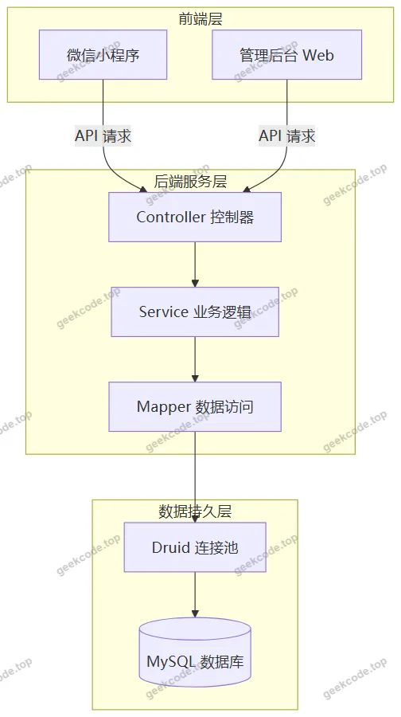</a>

<h2>功能模块</h2>

根据源码 Controller 列表及截图功能，系统分为前台用户端（小程序）和后台管理端两大模块。

<h3>1. 前台用户端（微信小程序）</h3>

面向普通注册用户，提供便捷的政务服务入口。

<ul>
<li><strong>首页与服务浏览</strong>: 展示平台首页框架，支持查看“服务信息”列表及详情，了解各类办事指南。</li>
<li><strong>个人中心</strong>: 用户可登录、注册、修改个人信息、重置密码。支持查看“我的收藏”列表。</li>
<li><strong>业务办理</strong>:</li>
<li><strong>预约信息</strong>: 查看预约信息列表及详情，进行办事预约。</li>
<li><strong>报案信息</strong>: 提交并查看报案信息列表及详情。</li>
<li><strong>立案信息</strong>: 查看个人相关的立案信息列表及详情。</li>
<li><strong>案件进展</strong>: 实时追踪案件处理进度，查看案件进展列表及详情。</li>
</ul>
<h3>2. 后台管理端</h3>

面向管理员，提供全面的数据维护与管理功能。

<ul>
<li><strong>基础数据管理</strong>:</li>
<li><strong>类型管理</strong>: 维护服务分类、案件类型等字典数据 (<code>/leixing</code>)。</li>
<li><strong>新闻管理</strong>: 发布和管理新闻资讯内容 (<code>/news</code>)。</li>
<li><strong>配置管理</strong>: 系统参数配置 (<code>/config</code>)。</li>
<li><strong>人员与账号管理</strong>:</li>
<li><strong>用户管理</strong>: 审核、编辑、删除注册用户信息 (<code>/yonghu</code>)。</li>
<li><strong>民警管理</strong>: 维护民警档案信息 (<code>/minjing</code>)。</li>
<li><strong>业务数据管理</strong>:</li>
<li><strong>服务信息管理</strong>: 维护对外展示的服务指南 (<code>/fuwuxinxi</code>)。</li>
<li><strong>报案信息管理</strong>: 处理用户提交的报案记录 (<code>/baoanxinxi</code>)。</li>
<li><strong>预约信息管理</strong>: 管理用户的预约请求 (<code>/yuyuexinxi</code>)。</li>
<li><strong>立案信息管理</strong>: 维护案件立案状态 (<code>/lianxinxi</code>)。</li>
<li><strong>案件进展管理</strong>: 更新案件处理进度 (<code>/anjianjinzhan</code>)。</li>
<li><strong>收藏管理</strong>: 查看用户收藏记录 (<code>/storeup</code>)。</li>
<li><strong>文件管理</strong>: 通过 <code>FileController</code> 处理上传下载，<code>CommonController</code> 提供通用接口支持。</li>
</ul>
<h2>用户角色与权限</h2>

系统主要涉及两类角色，权限划分清晰：

<ol>
<li><strong>普通用户 (User)</strong>:</li>
</ol>
<ul>
<li><strong>权限范围</strong>: 仅能访问微信小程序前台。</li>
<li><strong>功能权限</strong>: 注册/登录、浏览服务信息与新闻、提交报案/预约申请、查询个人案件进展与立案信息、管理个人资料、收藏感兴趣的内容。无法进入后台管理页面。</li>
</ul>
<ol start="2">
<li><strong>管理员 (Admin)</strong>:</li>
</ol>
<ul>
<li><strong>权限范围</strong>: 拥有后台管理系统的所有操作权限。</li>
<li><strong>功能权限</strong>: 可对用户、民警、类型、新闻、服务信息、报案信息、预约信息、立案信息、案件进展、收藏记录及系统配置进行增删改查操作。同时具备文件上传管理能力。</li>
</ul>

<em>注：根据现有代码上下文，未明确区分“教师”、“学生”等其他特定角色，系统主要服务于政务场景下的管理者与被管理者。</em>

<h2>项目特色与创新点</h2>
<ol>
<li><strong>移动端优先体验</strong>: 深度整合微信小程序生态，无需下载安装即可使用，降低了用户使用门槛，符合“最多跑一次”改革中便民利民的初衷。</li>
<li><strong>全流程可视化追踪</strong>: 针对案件处理周期长、反馈慢的痛点，设计了“案件进展”与“立案信息”模块，让用户能实时掌握办事动态，提升了政务透明度。</li>
<li><strong>高效的技术栈组合</strong>: 采用 Spring Boot + MyBatis-Plus + Druid 的经典组合，既保证了系统的稳定性和高并发处理能力，又通过 MyBatis-Plus 减少了大量重复的代码编写，提高了开发与维护效率。</li>
<li><strong>模块化后台管理</strong>: 后台路由清晰划分为 <code>/leixing</code>, <code>/news</code>, <code>/anjianjinzhan</code> 等独立模块，便于管理员针对不同业务板块进行精细化运营和维护。</li>
</ol>
<h2>部署环境</h2>

为确保系统正常运行，需准备以下软件环境：

<ul>
<li><strong>操作系统</strong>: Windows Server / Linux (CentOS/Ubuntu)</li>
<li><strong>Java 运行环境</strong>: JDK 1.8 及以上版本</li>
<li><strong>数据库</strong>: MySQL 5.7 或 MySQL 8.0</li>
<li><strong>构建工具</strong>: Maven 3.6+</li>
<li><strong>前端环境</strong>: Node.js (用于编译 Vue 前端资源)</li>
<li><strong>开发调试工具</strong>: </li>
<li>IntelliJ IDEA 或 Eclipse (后端开发)</li>
<li>VS Code (前端开发)</li>
<li>微信开发者工具 (小程序调试与发布)</li>
<li><strong>服务器</strong>: Tomcat 8.5+ (内置于 Spring Boot，若独立部署需外部 Tomcat)</li>
</ul>
<h2>五、技术特性</h2>
<ul>
<li>前后端集成部署，前端资源打包至后端 static 目录</li>
<li>使用 MyBatis-Plus 简化数据访问层开发</li>
</ul>
<h2>六、功能模块截图</h2>
<h3>前台用户端</h3>
<h4>前台首页框架</h4>

<a href="https://geekcode.top/archives/%E2%80%9C%E6%9C%80%E5%A4%9A%E8%B7%91%E4%B8%80%E6%AC%A1%E2%80%9D%E5%BE%AE%E4%BF%A1%E5%B0%8F%E7%A8%8B%E5%BA%8F-%E8%AE%BA%E6%96%87?utm_source=github" title="查看完整源码">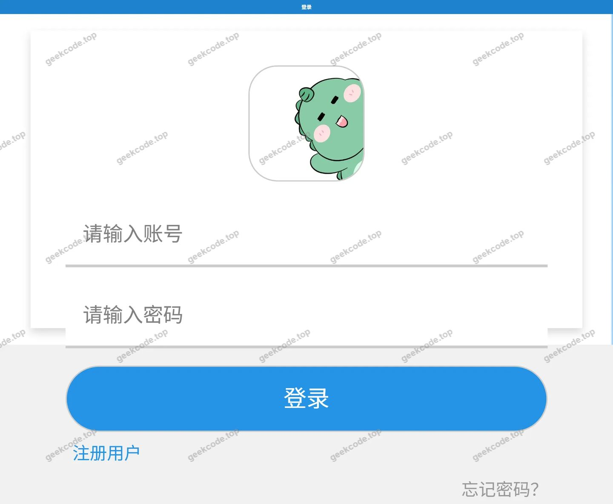</a>

<h3>微信小程序用户端</h3>

<figure><a href="https://geekcode.top/archives/%E2%80%9C%E6%9C%80%E5%A4%9A%E8%B7%91%E4%B8%80%E6%AC%A1%E2%80%9D%E5%BE%AE%E4%BF%A1%E5%B0%8F%E7%A8%8B%E5%BA%8F-%E8%AE%BA%E6%96%87?utm_source=github" title="查看完整源码">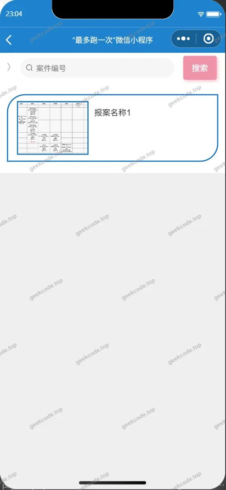</a><figcaption>小程序-案件进展列表</figcaption></figure>
<figure><a href="https://geekcode.top/archives/%E2%80%9C%E6%9C%80%E5%A4%9A%E8%B7%91%E4%B8%80%E6%AC%A1%E2%80%9D%E5%BE%AE%E4%BF%A1%E5%B0%8F%E7%A8%8B%E5%BA%8F-%E8%AE%BA%E6%96%87?utm_source=github" title="查看完整源码">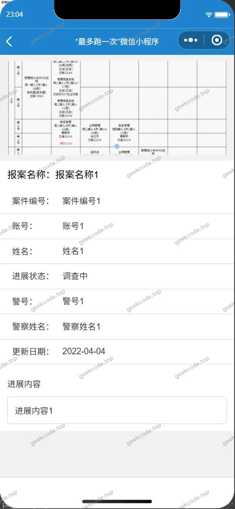</a><figcaption>小程序-案件进展详情</figcaption></figure>
<figure><figcaption>小程序-报案信息列表</figcaption></figure>
<figure><figcaption>小程序-报案信息详情</figcaption></figure>
<figure><figcaption>小程序-登录</figcaption></figure>
<figure><figcaption>小程序-服务信息</figcaption></figure>
<figure><a href="https://geekcode.top/archives/%E2%80%9C%E6%9C%80%E5%A4%9A%E8%B7%91%E4%B8%80%E6%AC%A1%E2%80%9D%E5%BE%AE%E4%BF%A1%E5%B0%8F%E7%A8%8B%E5%BA%8F-%E8%AE%BA%E6%96%87?utm_source=github" title="查看完整源码">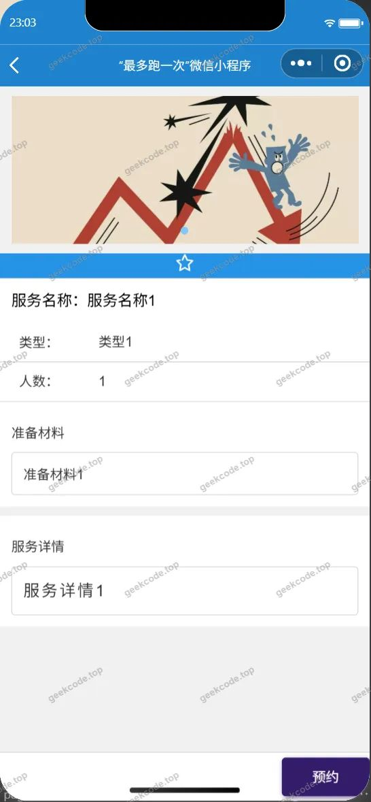</a><figcaption>小程序-服务信息详情</figcaption></figure>
<figure><figcaption>小程序-个人信息</figcaption></figure>
<figure><figcaption>小程序-立案信息列表</figcaption></figure>
<figure><figcaption>小程序-立案信息详情</figcaption></figure>
<figure><a href="https://geekcode.top/archives/%E2%80%9C%E6%9C%80%E5%A4%9A%E8%B7%91%E4%B8%80%E6%AC%A1%E2%80%9D%E5%BE%AE%E4%BF%A1%E5%B0%8F%E7%A8%8B%E5%BA%8F-%E8%AE%BA%E6%96%87?utm_source=github" title="查看完整源码">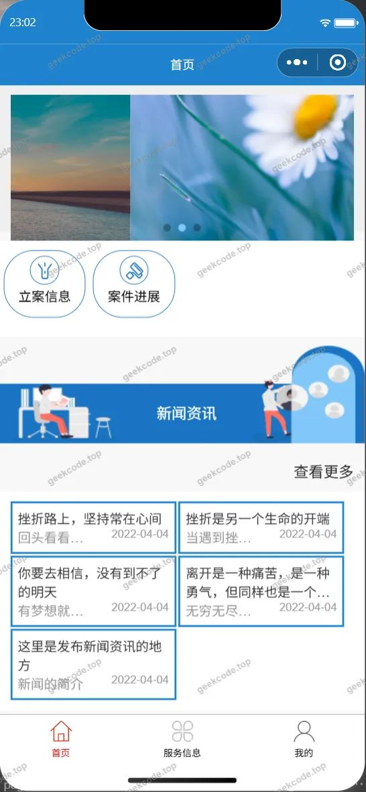</a><figcaption>小程序-首页</figcaption></figure>
<figure><figcaption>小程序-忘记密码</figcaption></figure>
<figure><a href="https://geekcode.top/archives/%E2%80%9C%E6%9C%80%E5%A4%9A%E8%B7%91%E4%B8%80%E6%AC%A1%E2%80%9D%E5%BE%AE%E4%BF%A1%E5%B0%8F%E7%A8%8B%E5%BA%8F-%E8%AE%BA%E6%96%87?utm_source=github" title="查看完整源码">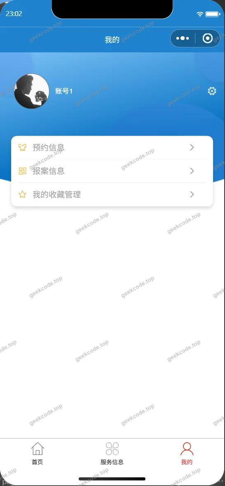</a><figcaption>小程序-我的</figcaption></figure>
<figure><figcaption>小程序-我的收藏列表</figcaption></figure>
<figure><figcaption>小程序-预约信息列表</figcaption></figure>
<figure><a href="https://geekcode.top/archives/%E2%80%9C%E6%9C%80%E5%A4%9A%E8%B7%91%E4%B8%80%E6%AC%A1%E2%80%9D%E5%BE%AE%E4%BF%A1%E5%B0%8F%E7%A8%8B%E5%BA%8F-%E8%AE%BA%E6%96%87?utm_source=github" title="查看完整源码">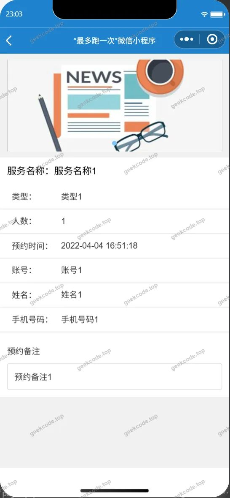</a><figcaption>小程序-预约信息详情</figcaption></figure>
<figure><a href="https://geekcode.top/archives/%E2%80%9C%E6%9C%80%E5%A4%9A%E8%B7%91%E4%B8%80%E6%AC%A1%E2%80%9D%E5%BE%AE%E4%BF%A1%E5%B0%8F%E7%A8%8B%E5%BA%8F-%E8%AE%BA%E6%96%87?utm_source=github" title="查看完整源码">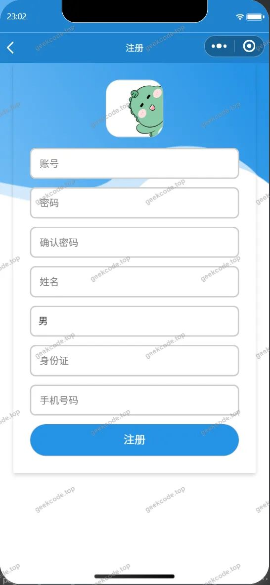</a><figcaption>小程序-注册</figcaption></figure>

<h3>微信小程序管理端</h3>

<figure><figcaption>小程序-管理端-类型列表</figcaption></figure>
<figure><figcaption>小程序-管理端-民警列表</figcaption></figure>
<figure><figcaption>小程序-管理端-民警详情</figcaption></figure>
<figure><figcaption>小程序-管理端-新闻资讯列表</figcaption></figure>
<figure><figcaption>小程序-管理端-用户列表</figcaption></figure>
<figure><figcaption>小程序-管理端-用户详情</figcaption></figure>

<h3>后台管理端</h3>
<h4>后台-案件进展</h4>

<a href="https://geekcode.top/archives/%E2%80%9C%E6%9C%80%E5%A4%9A%E8%B7%91%E4%B8%80%E6%AC%A1%E2%80%9D%E5%BE%AE%E4%BF%A1%E5%B0%8F%E7%A8%8B%E5%BA%8F-%E8%AE%BA%E6%96%87?utm_source=github" title="查看完整源码">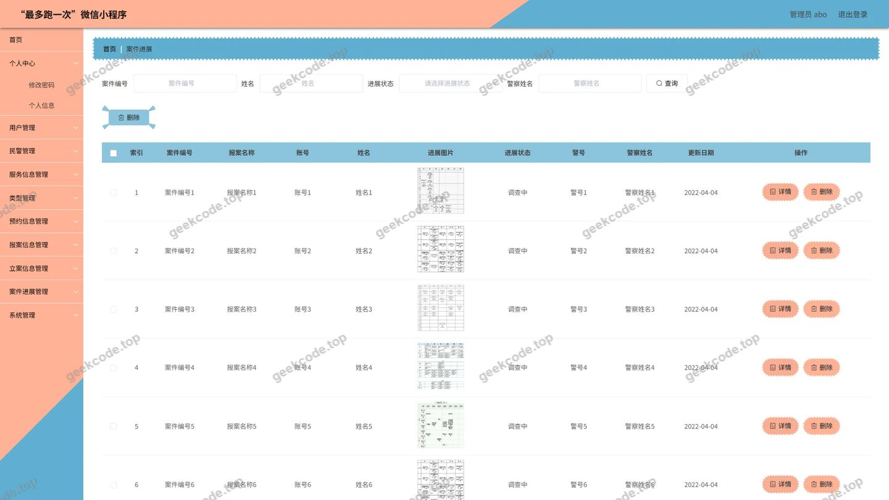</a>

<h4>后台-登录页</h4>

<h4>后台-服务信息</h4>

<a href="https://geekcode.top/archives/%E2%80%9C%E6%9C%80%E5%A4%9A%E8%B7%91%E4%B8%80%E6%AC%A1%E2%80%9D%E5%BE%AE%E4%BF%A1%E5%B0%8F%E7%A8%8B%E5%BA%8F-%E8%AE%BA%E6%96%87?utm_source=github" title="查看完整源码">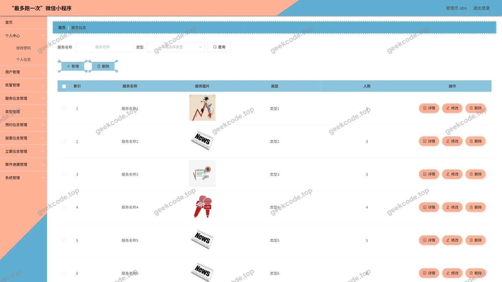</a>

<h4>后台-类型</h4>

<a href="https://geekcode.top/archives/%E2%80%9C%E6%9C%80%E5%A4%9A%E8%B7%91%E4%B8%80%E6%AC%A1%E2%80%9D%E5%BE%AE%E4%BF%A1%E5%B0%8F%E7%A8%8B%E5%BA%8F-%E8%AE%BA%E6%96%87?utm_source=github" title="查看完整源码">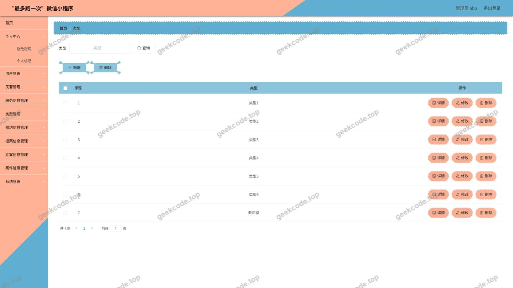</a>

<h4>后台-民警</h4>

<a href="https://geekcode.top/archives/%E2%80%9C%E6%9C%80%E5%A4%9A%E8%B7%91%E4%B8%80%E6%AC%A1%E2%80%9D%E5%BE%AE%E4%BF%A1%E5%B0%8F%E7%A8%8B%E5%BA%8F-%E8%AE%BA%E6%96%87?utm_source=github" title="查看完整源码">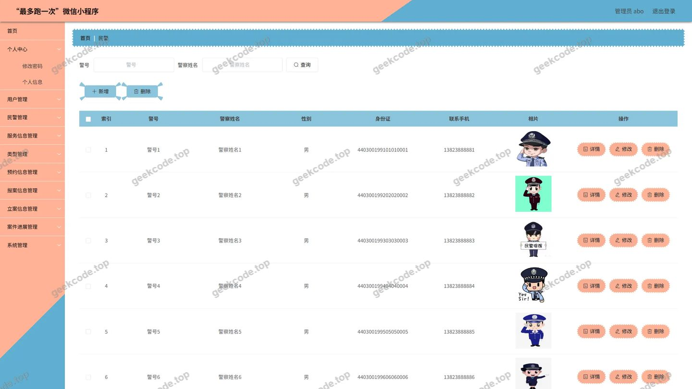</a>

<h4>后台首页</h4>

<h4>后台-新闻资讯</h4>

<a href="https://geekcode.top/archives/%E2%80%9C%E6%9C%80%E5%A4%9A%E8%B7%91%E4%B8%80%E6%AC%A1%E2%80%9D%E5%BE%AE%E4%BF%A1%E5%B0%8F%E7%A8%8B%E5%BA%8F-%E8%AE%BA%E6%96%87?utm_source=github" title="查看完整源码">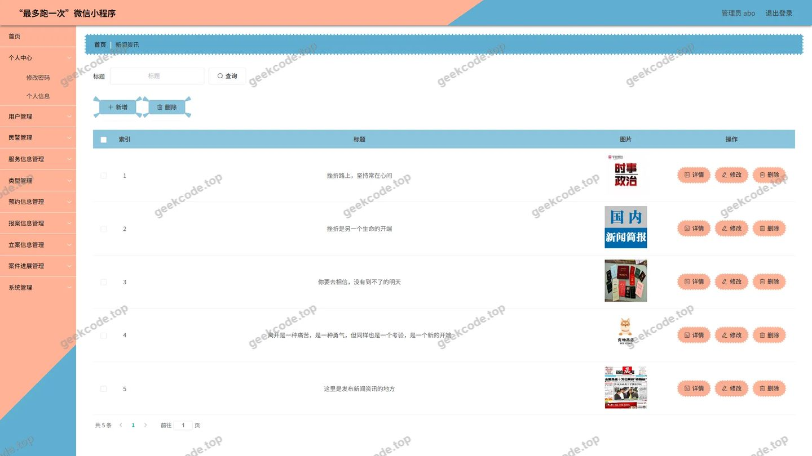</a>

<h4>后台-用户</h4>

<a href="https://geekcode.top/archives/%E2%80%9C%E6%9C%80%E5%A4%9A%E8%B7%91%E4%B8%80%E6%AC%A1%E2%80%9D%E5%BE%AE%E4%BF%A1%E5%B0%8F%E7%A8%8B%E5%BA%8F-%E8%AE%BA%E6%96%87?utm_source=github" title="查看完整源码">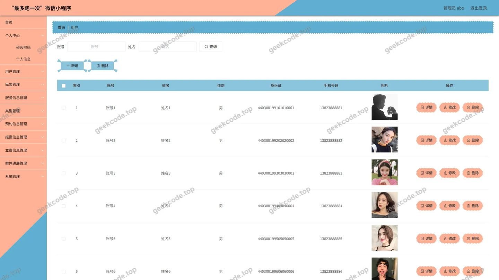</a>

---

## 获取完整源码

| 项目 | 说明 |
| --- | --- |
| 项目名 | “最多跑一次”微信小程序--论文 |
| 运行截图 | 本文 33 张（站点带水印原图，仓库 `images/` 目录） |
| 完整源码 | [https://geekcode.top/archives/%E2%80%9C%E6%9C%80%E5%A4%9A%E8%B7%91%E4%B8%80%E6%AC%A1%E2%80%9D%E5%BE%AE%E4%BF%A1%E5%B0%8F%E7%A8%8B%E5%BA%8F-%E8%AE%BA%E6%96%87?utm_source=github](https://geekcode.top/archives/%E2%80%9C%E6%9C%80%E5%A4%9A%E8%B7%91%E4%B8%80%E6%AC%A1%E2%80%9D%E5%BE%AE%E4%BF%A1%E5%B0%8F%E7%A8%8B%E5%BA%8F-%E8%AE%BA%E6%96%87?utm_source=github) |
| 咨询微信 | **ir9372**（备注：jingpin-yuanma） |
| 更多项目 | [极客代码 geekcode.top](https://geekcode.top/?utm_source=github) |

> 需要源码、部署、改配置、跑不起来等问题，加微信 ir9372 沟通，说明项目名即可。
